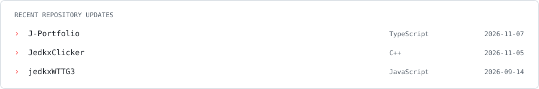

<!-- Generated by scripts/render-assets.mjs. Edit data/profile.json, not this file. -->
<a href="https://jedkx.github.io/J-Portfolio/">
<picture>
  <source media="(max-width: 600px) and (prefers-color-scheme: dark)" srcset="https://raw.githubusercontent.com/jedkx/jedkx/main/assets/header-mobile-dark.svg?v=e7cbcd5144d1">
  <source media="(max-width: 600px)" srcset="https://raw.githubusercontent.com/jedkx/jedkx/main/assets/header-mobile-light.svg?v=8638f9d9b471">
  <source media="(prefers-color-scheme: dark)" srcset="https://raw.githubusercontent.com/jedkx/jedkx/main/assets/header-dark.svg?v=b103b53e394f">
  
</picture>
</a>

<a href="https://jedkx.github.io/J-Portfolio/">Portfolio ↗</a> &nbsp; / &nbsp; <a href="https://drive.google.com/file/d/1AgQYEGXntEEDf31rzrcfPjonrO44K5Ao/view">Résumé</a> &nbsp; / &nbsp; <a href="mailto:ccoskun742@gmail.com">Email</a> &nbsp; / &nbsp; <a href="https://www.linkedin.com/in/caner-co%C5%9Fkun/">LinkedIn</a>

I build software across the stack, with a soft spot for games, playful interfaces and small computers.

**Working with** C# / ASP.NET Core · TypeScript / React · Python · Go · C/C++

### Selected work

<picture>
  <source media="(max-width: 600px) and (prefers-color-scheme: dark)" srcset="https://raw.githubusercontent.com/jedkx/jedkx/main/assets/projects-mobile-dark.svg?v=91e6cb56471f">
  <source media="(max-width: 600px)" srcset="https://raw.githubusercontent.com/jedkx/jedkx/main/assets/projects-mobile-light.svg?v=de3f1bd5e268">
  <source media="(prefers-color-scheme: dark)" srcset="https://raw.githubusercontent.com/jedkx/jedkx/main/assets/projects-dark.svg?v=c22adea25e28">
  
</picture>

<a href="https://github.com/jedkx/J-Portfolio">J-Portfolio ↗</a> &nbsp; / &nbsp; <a href="https://github.com/jedkx/openground">openground ↗</a> &nbsp; / &nbsp; <a href="https://github.com/jedkx/DxReportReview">DxReportReview ↗</a> &nbsp; / &nbsp; <a href="https://github.com/jedkx/Relay">Relay ↗</a>

### Contribution trail

<picture>
  <source media="(prefers-reduced-motion: reduce) and (prefers-color-scheme: dark)" srcset="https://raw.githubusercontent.com/jedkx/jedkx/main/assets/snake-static-dark.svg?v=6a2719b7c831">
  <source media="(prefers-reduced-motion: reduce)" srcset="https://raw.githubusercontent.com/jedkx/jedkx/main/assets/snake-static-light.svg?v=05c85a8266ff">
  <source media="(prefers-color-scheme: dark)" srcset="https://raw.githubusercontent.com/jedkx/jedkx/main/assets/snake-dark.svg?v=3365eb5dc085">
  
</picture>

### Recent work

<picture>
  <source media="(max-width: 600px) and (prefers-color-scheme: dark)" srcset="https://raw.githubusercontent.com/jedkx/jedkx/main/assets/activity-mobile-dark.svg?v=88b35133c9a1">
  <source media="(max-width: 600px)" srcset="https://raw.githubusercontent.com/jedkx/jedkx/main/assets/activity-mobile-light.svg?v=1bf6317950b2">
  <source media="(prefers-color-scheme: dark)" srcset="https://raw.githubusercontent.com/jedkx/jedkx/main/assets/activity-dark.svg?v=3f43d263b651">
  
</picture>
