<!-- Generated by scripts/render-assets.mjs. Edit data/profile.json, not this file. -->
<a href="https://jedkx.github.io/J-Portfolio/">
<picture>
  <source media="(max-width: 600px) and (prefers-color-scheme: dark)" srcset="https://raw.githubusercontent.com/jedkx/jedkx/main/assets/header-mobile-dark.svg?v=a67a433f59bc">
  <source media="(max-width: 600px)" srcset="https://raw.githubusercontent.com/jedkx/jedkx/main/assets/header-mobile-light.svg?v=6d6ada6e64da">
  <source media="(prefers-color-scheme: dark)" srcset="https://raw.githubusercontent.com/jedkx/jedkx/main/assets/header-dark.svg?v=0a2215b20efa">
  
</picture>
</a>

<a href="https://jedkx.github.io/J-Portfolio/">Portfolio ↗</a> &nbsp; / &nbsp; <a href="https://drive.google.com/file/d/1AgQYEGXntEEDf31rzrcfPjonrO44K5Ao/view">Résumé</a> &nbsp; / &nbsp; <a href="mailto:ccoskun742@gmail.com">Email</a> &nbsp; / &nbsp; <a href="https://www.linkedin.com/in/caner-co%C5%9Fkun/">LinkedIn</a>

<picture>
  <source media="(max-width: 600px) and (prefers-color-scheme: dark)" srcset="https://raw.githubusercontent.com/jedkx/jedkx/main/assets/work-top-mobile-dark.svg?v=1ff246d9acac">
  <source media="(max-width: 600px)" srcset="https://raw.githubusercontent.com/jedkx/jedkx/main/assets/work-top-mobile-light.svg?v=284d21d380ea">
  <source media="(prefers-color-scheme: dark)" srcset="https://raw.githubusercontent.com/jedkx/jedkx/main/assets/work-top-dark.svg?v=d54c54676f13">
  
</picture> 
<a href="https://github.com/jedkx/J-Portfolio">
<picture>
  <source media="(max-width: 600px) and (prefers-color-scheme: dark)" srcset="https://raw.githubusercontent.com/jedkx/jedkx/main/assets/work-j-portfolio-mobile-dark.svg?v=0b6ceaec264b">
  <source media="(max-width: 600px)" srcset="https://raw.githubusercontent.com/jedkx/jedkx/main/assets/work-j-portfolio-mobile-light.svg?v=d396396b6255">
  <source media="(prefers-color-scheme: dark)" srcset="https://raw.githubusercontent.com/jedkx/jedkx/main/assets/work-j-portfolio-dark.svg?v=0df97331fb3e">
  
</picture>
</a> 
<a href="https://github.com/jedkx/openground">
<picture>
  <source media="(max-width: 600px) and (prefers-color-scheme: dark)" srcset="https://raw.githubusercontent.com/jedkx/jedkx/main/assets/work-openground-mobile-dark.svg?v=45f7f61b40b3">
  <source media="(max-width: 600px)" srcset="https://raw.githubusercontent.com/jedkx/jedkx/main/assets/work-openground-mobile-light.svg?v=25fce8ad7102">
  <source media="(prefers-color-scheme: dark)" srcset="https://raw.githubusercontent.com/jedkx/jedkx/main/assets/work-openground-dark.svg?v=7a40d44ef771">
  
</picture>
</a> 
<a href="https://github.com/jedkx/DxReportReview">
<picture>
  <source media="(max-width: 600px) and (prefers-color-scheme: dark)" srcset="https://raw.githubusercontent.com/jedkx/jedkx/main/assets/work-dxreportreview-mobile-dark.svg?v=0c93b134104a">
  <source media="(max-width: 600px)" srcset="https://raw.githubusercontent.com/jedkx/jedkx/main/assets/work-dxreportreview-mobile-light.svg?v=81b6b9718fc7">
  <source media="(prefers-color-scheme: dark)" srcset="https://raw.githubusercontent.com/jedkx/jedkx/main/assets/work-dxreportreview-dark.svg?v=a930f874aef0">
  
</picture>
</a> 
<a href="https://github.com/jedkx/jedkx-cli">
<picture>
  <source media="(max-width: 600px) and (prefers-color-scheme: dark)" srcset="https://raw.githubusercontent.com/jedkx/jedkx/main/assets/work-jedkx-cli-mobile-dark.svg?v=b2b1a9622312">
  <source media="(max-width: 600px)" srcset="https://raw.githubusercontent.com/jedkx/jedkx/main/assets/work-jedkx-cli-mobile-light.svg?v=478afdfb4ed1">
  <source media="(prefers-color-scheme: dark)" srcset="https://raw.githubusercontent.com/jedkx/jedkx/main/assets/work-jedkx-cli-dark.svg?v=cedafbd8b419">
  
</picture>
</a> 
<picture>
  <source media="(max-width: 600px) and (prefers-color-scheme: dark)" srcset="https://raw.githubusercontent.com/jedkx/jedkx/main/assets/work-bottom-mobile-dark.svg?v=0ac06238e3b4">
  <source media="(max-width: 600px)" srcset="https://raw.githubusercontent.com/jedkx/jedkx/main/assets/work-bottom-mobile-light.svg?v=61ac3f709fab">
  <source media="(prefers-color-scheme: dark)" srcset="https://raw.githubusercontent.com/jedkx/jedkx/main/assets/work-bottom-dark.svg?v=ee3e4c089a9b">
  
</picture>

 

<picture>
  <source media="(prefers-reduced-motion: reduce) and (prefers-color-scheme: dark)" srcset="https://raw.githubusercontent.com/jedkx/jedkx/main/assets/snake-static-dark.svg?v=740122af43c5">
  <source media="(prefers-reduced-motion: reduce)" srcset="https://raw.githubusercontent.com/jedkx/jedkx/main/assets/snake-static-light.svg?v=3baeff8c9a11">
  <source media="(prefers-color-scheme: dark)" srcset="https://raw.githubusercontent.com/jedkx/jedkx/main/assets/snake-dark.svg?v=c9293fbce090">
  
</picture>

