<!-- Generated by scripts/render-assets.mjs. Edit data/profile.json, not this file. -->
<a href="https://jedkx.github.io/J-Portfolio/">
<picture>
  <source media="(max-width: 600px) and (prefers-color-scheme: dark)" srcset="https://raw.githubusercontent.com/jedkx/jedkx/main/assets/header-mobile-dark.svg?v=a67a433f59bc">
  <source media="(max-width: 600px)" srcset="https://raw.githubusercontent.com/jedkx/jedkx/main/assets/header-mobile-light.svg?v=6d6ada6e64da">
  <source media="(prefers-color-scheme: dark)" srcset="https://raw.githubusercontent.com/jedkx/jedkx/main/assets/header-dark.svg?v=0a2215b20efa">
  
</picture>
</a>

<a href="https://jedkx.github.io/J-Portfolio/">Portfolio ↗</a> &nbsp; / &nbsp; <a href="https://drive.google.com/file/d/1AgQYEGXntEEDf31rzrcfPjonrO44K5Ao/view">Résumé</a> &nbsp; / &nbsp; <a href="mailto:ccoskun742@gmail.com">Email</a> &nbsp; / &nbsp; <a href="https://www.linkedin.com/in/caner-co%C5%9Fkun/">LinkedIn</a>

<picture>
  <source media="(max-width: 600px) and (prefers-color-scheme: dark)" srcset="https://raw.githubusercontent.com/jedkx/jedkx/main/assets/work-top-mobile-dark.svg?v=7ec323342f88">
  <source media="(max-width: 600px)" srcset="https://raw.githubusercontent.com/jedkx/jedkx/main/assets/work-top-mobile-light.svg?v=9d34fc3ddfd5">
  <source media="(prefers-color-scheme: dark)" srcset="https://raw.githubusercontent.com/jedkx/jedkx/main/assets/work-top-dark.svg?v=da7465fb84ef">
  
</picture> 
<a href="https://github.com/jedkx/J-Portfolio">
<picture>
  <source media="(max-width: 600px) and (prefers-color-scheme: dark)" srcset="https://raw.githubusercontent.com/jedkx/jedkx/main/assets/work-j-portfolio-mobile-dark.svg?v=6104cabe2841">
  <source media="(max-width: 600px)" srcset="https://raw.githubusercontent.com/jedkx/jedkx/main/assets/work-j-portfolio-mobile-light.svg?v=56ded5872dbd">
  <source media="(prefers-color-scheme: dark)" srcset="https://raw.githubusercontent.com/jedkx/jedkx/main/assets/work-j-portfolio-dark.svg?v=ff2ae0ea517e">
  
</picture>
</a> 
<a href="https://github.com/jedkx/openground">
<picture>
  <source media="(max-width: 600px) and (prefers-color-scheme: dark)" srcset="https://raw.githubusercontent.com/jedkx/jedkx/main/assets/work-openground-mobile-dark.svg?v=6095252c00b0">
  <source media="(max-width: 600px)" srcset="https://raw.githubusercontent.com/jedkx/jedkx/main/assets/work-openground-mobile-light.svg?v=e4944236f9bd">
  <source media="(prefers-color-scheme: dark)" srcset="https://raw.githubusercontent.com/jedkx/jedkx/main/assets/work-openground-dark.svg?v=e7e391796c4c">
  
</picture>
</a> 
<a href="https://github.com/jedkx/DxReportReview">
<picture>
  <source media="(max-width: 600px) and (prefers-color-scheme: dark)" srcset="https://raw.githubusercontent.com/jedkx/jedkx/main/assets/work-dxreportreview-mobile-dark.svg?v=1627e9e7a444">
  <source media="(max-width: 600px)" srcset="https://raw.githubusercontent.com/jedkx/jedkx/main/assets/work-dxreportreview-mobile-light.svg?v=80bb7c3cc036">
  <source media="(prefers-color-scheme: dark)" srcset="https://raw.githubusercontent.com/jedkx/jedkx/main/assets/work-dxreportreview-dark.svg?v=7af1cfd60dc0">
  
</picture>
</a> 
<a href="https://github.com/jedkx/jedkx-cli">
<picture>
  <source media="(max-width: 600px) and (prefers-color-scheme: dark)" srcset="https://raw.githubusercontent.com/jedkx/jedkx/main/assets/work-jedkx-cli-mobile-dark.svg?v=849f252a4c1e">
  <source media="(max-width: 600px)" srcset="https://raw.githubusercontent.com/jedkx/jedkx/main/assets/work-jedkx-cli-mobile-light.svg?v=5face8c36de7">
  <source media="(prefers-color-scheme: dark)" srcset="https://raw.githubusercontent.com/jedkx/jedkx/main/assets/work-jedkx-cli-dark.svg?v=52b0e7d486ff">
  
</picture>
</a> 
<picture>
  <source media="(max-width: 600px) and (prefers-color-scheme: dark)" srcset="https://raw.githubusercontent.com/jedkx/jedkx/main/assets/work-bottom-mobile-dark.svg?v=774bf166ffbc">
  <source media="(max-width: 600px)" srcset="https://raw.githubusercontent.com/jedkx/jedkx/main/assets/work-bottom-mobile-light.svg?v=15f0ae768218">
  <source media="(prefers-color-scheme: dark)" srcset="https://raw.githubusercontent.com/jedkx/jedkx/main/assets/work-bottom-dark.svg?v=be828bd0a19d">
  
</picture>

 

<picture>
  <source media="(prefers-reduced-motion: reduce) and (prefers-color-scheme: dark)" srcset="https://raw.githubusercontent.com/jedkx/jedkx/main/assets/snake-static-dark.svg?v=4e4b200b2ac0">
  <source media="(prefers-reduced-motion: reduce)" srcset="https://raw.githubusercontent.com/jedkx/jedkx/main/assets/snake-static-light.svg?v=0721a5f7c2c3">
  <source media="(prefers-color-scheme: dark)" srcset="https://raw.githubusercontent.com/jedkx/jedkx/main/assets/snake-dark.svg?v=3c32e57855ac">
  
</picture>

