<!-- Generated by scripts/render-assets.mjs. Edit data/profile.json, not this file. -->
<a href="https://jedkx.github.io/J-Portfolio/">
<picture>
  <source media="(max-width: 600px) and (prefers-color-scheme: dark)" srcset="https://raw.githubusercontent.com/jedkx/jedkx/main/assets/header-mobile-dark.svg?v=a67a433f59bc">
  <source media="(max-width: 600px)" srcset="https://raw.githubusercontent.com/jedkx/jedkx/main/assets/header-mobile-light.svg?v=6d6ada6e64da">
  <source media="(prefers-color-scheme: dark)" srcset="https://raw.githubusercontent.com/jedkx/jedkx/main/assets/header-dark.svg?v=0a2215b20efa">
  
</picture>
</a>

<a href="https://jedkx.github.io/J-Portfolio/">Portfolio ↗</a> &nbsp; / &nbsp; <a href="https://drive.google.com/file/d/1AgQYEGXntEEDf31rzrcfPjonrO44K5Ao/view">Résumé</a> &nbsp; / &nbsp; <a href="mailto:ccoskun742@gmail.com">Email</a> &nbsp; / &nbsp; <a href="https://www.linkedin.com/in/caner-co%C5%9Fkun/">LinkedIn</a>

<picture>
  <source media="(max-width: 600px) and (prefers-color-scheme: dark)" srcset="https://raw.githubusercontent.com/jedkx/jedkx/main/assets/work-top-mobile-dark.svg?v=6e6511c04eba">
  <source media="(max-width: 600px)" srcset="https://raw.githubusercontent.com/jedkx/jedkx/main/assets/work-top-mobile-light.svg?v=afcf2c36771a">
  <source media="(prefers-color-scheme: dark)" srcset="https://raw.githubusercontent.com/jedkx/jedkx/main/assets/work-top-dark.svg?v=54da04110b9a">
  
</picture> 
<a href="https://github.com/jedkx/J-Portfolio">
<picture>
  <source media="(max-width: 600px) and (prefers-color-scheme: dark)" srcset="https://raw.githubusercontent.com/jedkx/jedkx/main/assets/work-j-portfolio-mobile-dark.svg?v=36f2cab1cf90">
  <source media="(max-width: 600px)" srcset="https://raw.githubusercontent.com/jedkx/jedkx/main/assets/work-j-portfolio-mobile-light.svg?v=18ff8fc2d679">
  <source media="(prefers-color-scheme: dark)" srcset="https://raw.githubusercontent.com/jedkx/jedkx/main/assets/work-j-portfolio-dark.svg?v=9d547c6e1e3c">
  
</picture>
</a> 
<a href="https://github.com/jedkx/openground">
<picture>
  <source media="(max-width: 600px) and (prefers-color-scheme: dark)" srcset="https://raw.githubusercontent.com/jedkx/jedkx/main/assets/work-openground-mobile-dark.svg?v=094bc602f1f3">
  <source media="(max-width: 600px)" srcset="https://raw.githubusercontent.com/jedkx/jedkx/main/assets/work-openground-mobile-light.svg?v=455992291d88">
  <source media="(prefers-color-scheme: dark)" srcset="https://raw.githubusercontent.com/jedkx/jedkx/main/assets/work-openground-dark.svg?v=88ae100eec72">
  
</picture>
</a> 
<a href="https://github.com/jedkx/DxReportReview">
<picture>
  <source media="(max-width: 600px) and (prefers-color-scheme: dark)" srcset="https://raw.githubusercontent.com/jedkx/jedkx/main/assets/work-dxreportreview-mobile-dark.svg?v=858e63342b80">
  <source media="(max-width: 600px)" srcset="https://raw.githubusercontent.com/jedkx/jedkx/main/assets/work-dxreportreview-mobile-light.svg?v=90f7538ac333">
  <source media="(prefers-color-scheme: dark)" srcset="https://raw.githubusercontent.com/jedkx/jedkx/main/assets/work-dxreportreview-dark.svg?v=feba11d29148">
  
</picture>
</a> 
<a href="https://github.com/jedkx/jedkx-cli">
<picture>
  <source media="(max-width: 600px) and (prefers-color-scheme: dark)" srcset="https://raw.githubusercontent.com/jedkx/jedkx/main/assets/work-jedkx-cli-mobile-dark.svg?v=65f0d403eda4">
  <source media="(max-width: 600px)" srcset="https://raw.githubusercontent.com/jedkx/jedkx/main/assets/work-jedkx-cli-mobile-light.svg?v=135ccc5d9202">
  <source media="(prefers-color-scheme: dark)" srcset="https://raw.githubusercontent.com/jedkx/jedkx/main/assets/work-jedkx-cli-dark.svg?v=1978c8d9d730">
  
</picture>
</a> 
<picture>
  <source media="(max-width: 600px) and (prefers-color-scheme: dark)" srcset="https://raw.githubusercontent.com/jedkx/jedkx/main/assets/work-bottom-mobile-dark.svg?v=09f418b30e62">
  <source media="(max-width: 600px)" srcset="https://raw.githubusercontent.com/jedkx/jedkx/main/assets/work-bottom-mobile-light.svg?v=08983c10c663">
  <source media="(prefers-color-scheme: dark)" srcset="https://raw.githubusercontent.com/jedkx/jedkx/main/assets/work-bottom-dark.svg?v=2fb49d0f3ec5">
  
</picture>

 

<picture>
  <source media="(prefers-reduced-motion: reduce) and (prefers-color-scheme: dark)" srcset="https://raw.githubusercontent.com/jedkx/jedkx/main/assets/snake-static-dark.svg?v=de85f9d34dae">
  <source media="(prefers-reduced-motion: reduce)" srcset="https://raw.githubusercontent.com/jedkx/jedkx/main/assets/snake-static-light.svg?v=ebcba143ee6a">
  <source media="(prefers-color-scheme: dark)" srcset="https://raw.githubusercontent.com/jedkx/jedkx/main/assets/snake-dark.svg?v=1ecd7310e829">
  
</picture>

