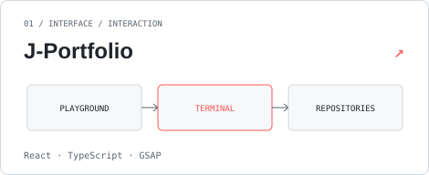
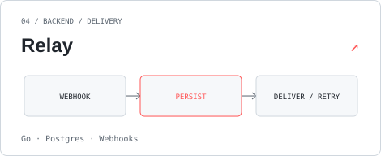
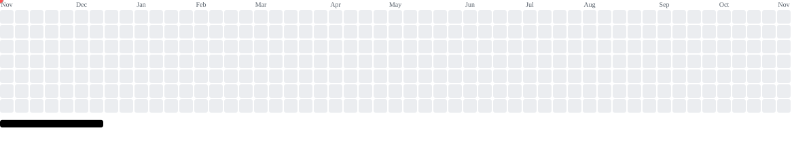

<!-- Generated by scripts/render-assets.mjs. Edit data/profile.json, not this file. -->
<a href="https://jedkx.github.io/J-Portfolio/">
<picture>
  <source media="(max-width: 600px) and (prefers-color-scheme: dark)" srcset="assets/header-mobile-dark.svg">
  <source media="(max-width: 600px)" srcset="assets/header-mobile-light.svg">
  <source media="(prefers-color-scheme: dark)" srcset="assets/header-dark.svg">
  
</picture>
</a>

<a href="https://jedkx.github.io/J-Portfolio/">Portfolio ↗</a> &nbsp; / &nbsp; <a href="https://drive.google.com/file/d/1AgQYEGXntEEDf31rzrcfPjonrO44K5Ao/view">Résumé</a> &nbsp; / &nbsp; <a href="mailto:ccoskun742@gmail.com">Email</a> &nbsp; / &nbsp; <a href="https://www.linkedin.com/in/caner-co%C5%9Fkun/">LinkedIn</a>

I build software across the stack, with a soft spot for games, playful interfaces and small computers.

**Working with** C# / ASP.NET Core · TypeScript / React · Python · Go · C/C++

### Selected work

<table>
<tr>
<td width="50%" valign="top">
<a href="https://github.com/jedkx/J-Portfolio"><picture>
  <source media="(prefers-color-scheme: dark)" srcset="assets/project-j-portfolio-dark.svg">
  
</picture></a>

**[J-Portfolio](https://github.com/jedkx/J-Portfolio)**

A terminal-inspired portfolio with particle physics, an original pixel character and a GitHub-powered project feed.

</td>
<td width="50%" valign="top">
<a href="https://github.com/jedkx/openground"><picture>
  <source media="(prefers-color-scheme: dark)" srcset="assets/project-openground-dark.svg">
  
</picture></a>

**[openground](https://github.com/jedkx/openground)**

A telemetry platform that connects data sources, streams live measurements and stores them in Postgres.

</td>
</tr>
<tr>
<td width="50%" valign="top">
<a href="https://github.com/jedkx/DxReportReview"><picture>
  <source media="(prefers-color-scheme: dark)" srcset="assets/project-dxreportreview-dark.svg">
  
</picture></a>

**[DxReportReview](https://github.com/jedkx/DxReportReview)**

Git-style review for DevExpress report layouts: submit, compare, then approve or reject before merge.

</td>
<td width="50%" valign="top">
<a href="https://github.com/jedkx/Relay"><picture>
  <source media="(prefers-color-scheme: dark)" srcset="assets/project-relay-dark.svg">
  
</picture></a>

**[Relay](https://github.com/jedkx/Relay)**

A Go service that persists webhook events and delivers them asynchronously, with retries and attempt logs.

</td>
</tr>
</table>

### A year, in bricks

My contribution calendar, played back as Breakout. [Play the real paddle game on my site ↗](https://jedkx.github.io/J-Portfolio/)

<picture>
  <source media="(prefers-reduced-motion: reduce) and (prefers-color-scheme: dark)" srcset="assets/breakout-static-dark.svg">
  <source media="(prefers-reduced-motion: reduce)" srcset="assets/breakout-static-light.svg">
  <source media="(prefers-color-scheme: dark)" srcset="assets/breakout-dark.svg">
  
</picture>

What I’ve been working on

<picture>
  <source media="(prefers-color-scheme: dark)" srcset="assets/activity-dark.svg">
  
</picture>

