<!-- Generated by scripts/render-assets.mjs. Edit data/profile.json, not this file. -->
<a href="https://jedkx.github.io/J-Portfolio/">
<picture>
  <source media="(max-width: 600px) and (prefers-color-scheme: dark)" srcset="https://raw.githubusercontent.com/jedkx/jedkx/main/assets/header-mobile-dark.svg?v=e7cbcd5144d1">
  <source media="(max-width: 600px)" srcset="https://raw.githubusercontent.com/jedkx/jedkx/main/assets/header-mobile-light.svg?v=8638f9d9b471">
  <source media="(prefers-color-scheme: dark)" srcset="https://raw.githubusercontent.com/jedkx/jedkx/main/assets/header-dark.svg?v=b103b53e394f">
  
</picture>
</a>

<a href="https://jedkx.github.io/J-Portfolio/">Portfolio ↗</a> &nbsp; / &nbsp; <a href="https://drive.google.com/file/d/1AgQYEGXntEEDf31rzrcfPjonrO44K5Ao/view">Résumé</a> &nbsp; / &nbsp; <a href="mailto:ccoskun742@gmail.com">Email</a> &nbsp; / &nbsp; <a href="https://www.linkedin.com/in/caner-co%C5%9Fkun/">LinkedIn</a>

I build software across the stack, with a soft spot for games, playful interfaces and small computers.

**Working with** C# / ASP.NET Core · TypeScript / React · Python · Go · C/C++

### Selected work

<picture>
  <source media="(max-width: 600px) and (prefers-color-scheme: dark)" srcset="https://raw.githubusercontent.com/jedkx/jedkx/main/assets/work-top-mobile-dark.svg?v=51dc764fcbc1">
  <source media="(max-width: 600px)" srcset="https://raw.githubusercontent.com/jedkx/jedkx/main/assets/work-top-mobile-light.svg?v=0e1c8b911492">
  <source media="(prefers-color-scheme: dark)" srcset="https://raw.githubusercontent.com/jedkx/jedkx/main/assets/work-top-dark.svg?v=9eac6c4dc1df">
  
</picture> 
<a href="https://github.com/jedkx/J-Portfolio">
<picture>
  <source media="(max-width: 600px) and (prefers-color-scheme: dark)" srcset="https://raw.githubusercontent.com/jedkx/jedkx/main/assets/work-j-portfolio-mobile-dark.svg?v=991e04fdf4e4">
  <source media="(max-width: 600px)" srcset="https://raw.githubusercontent.com/jedkx/jedkx/main/assets/work-j-portfolio-mobile-light.svg?v=55ab652ff42f">
  <source media="(prefers-color-scheme: dark)" srcset="https://raw.githubusercontent.com/jedkx/jedkx/main/assets/work-j-portfolio-dark.svg?v=e72632917a03">
  
</picture>
</a> 
<a href="https://github.com/jedkx/openground">
<picture>
  <source media="(max-width: 600px) and (prefers-color-scheme: dark)" srcset="https://raw.githubusercontent.com/jedkx/jedkx/main/assets/work-openground-mobile-dark.svg?v=b585ff04c297">
  <source media="(max-width: 600px)" srcset="https://raw.githubusercontent.com/jedkx/jedkx/main/assets/work-openground-mobile-light.svg?v=fe496aa34350">
  <source media="(prefers-color-scheme: dark)" srcset="https://raw.githubusercontent.com/jedkx/jedkx/main/assets/work-openground-dark.svg?v=e5b962817d99">
  
</picture>
</a> 
<a href="https://github.com/jedkx/DxReportReview">
<picture>
  <source media="(max-width: 600px) and (prefers-color-scheme: dark)" srcset="https://raw.githubusercontent.com/jedkx/jedkx/main/assets/work-dxreportreview-mobile-dark.svg?v=922c65257ef0">
  <source media="(max-width: 600px)" srcset="https://raw.githubusercontent.com/jedkx/jedkx/main/assets/work-dxreportreview-mobile-light.svg?v=eb0bbb81527e">
  <source media="(prefers-color-scheme: dark)" srcset="https://raw.githubusercontent.com/jedkx/jedkx/main/assets/work-dxreportreview-dark.svg?v=59aede5864f3">
  
</picture>
</a> 
<a href="https://github.com/jedkx/Relay">
<picture>
  <source media="(max-width: 600px) and (prefers-color-scheme: dark)" srcset="https://raw.githubusercontent.com/jedkx/jedkx/main/assets/work-relay-mobile-dark.svg?v=dcb89a0272fa">
  <source media="(max-width: 600px)" srcset="https://raw.githubusercontent.com/jedkx/jedkx/main/assets/work-relay-mobile-light.svg?v=586a0fefb5e3">
  <source media="(prefers-color-scheme: dark)" srcset="https://raw.githubusercontent.com/jedkx/jedkx/main/assets/work-relay-dark.svg?v=918593e8b6e5">
  
</picture>
</a> 
<picture>
  <source media="(max-width: 600px) and (prefers-color-scheme: dark)" srcset="https://raw.githubusercontent.com/jedkx/jedkx/main/assets/work-bottom-mobile-dark.svg?v=cc6701c586ad">
  <source media="(max-width: 600px)" srcset="https://raw.githubusercontent.com/jedkx/jedkx/main/assets/work-bottom-mobile-light.svg?v=a850148f5f7c">
  <source media="(prefers-color-scheme: dark)" srcset="https://raw.githubusercontent.com/jedkx/jedkx/main/assets/work-bottom-dark.svg?v=40a9f9b76103">
  
</picture>

### Contribution trail

<picture>
  <source media="(prefers-reduced-motion: reduce) and (prefers-color-scheme: dark)" srcset="https://raw.githubusercontent.com/jedkx/jedkx/main/assets/snake-static-dark.svg?v=db17c3a9b5a8">
  <source media="(prefers-reduced-motion: reduce)" srcset="https://raw.githubusercontent.com/jedkx/jedkx/main/assets/snake-static-light.svg?v=76c17cb3051d">
  <source media="(prefers-color-scheme: dark)" srcset="https://raw.githubusercontent.com/jedkx/jedkx/main/assets/snake-dark.svg?v=b2bd60a750ac">
  
</picture>

### Recent work

<picture>
  <source media="(max-width: 600px) and (prefers-color-scheme: dark)" srcset="https://raw.githubusercontent.com/jedkx/jedkx/main/assets/activity-mobile-dark.svg?v=88b35133c9a1">
  <source media="(max-width: 600px)" srcset="https://raw.githubusercontent.com/jedkx/jedkx/main/assets/activity-mobile-light.svg?v=1bf6317950b2">
  <source media="(prefers-color-scheme: dark)" srcset="https://raw.githubusercontent.com/jedkx/jedkx/main/assets/activity-dark.svg?v=3f43d263b651">
  
</picture>
